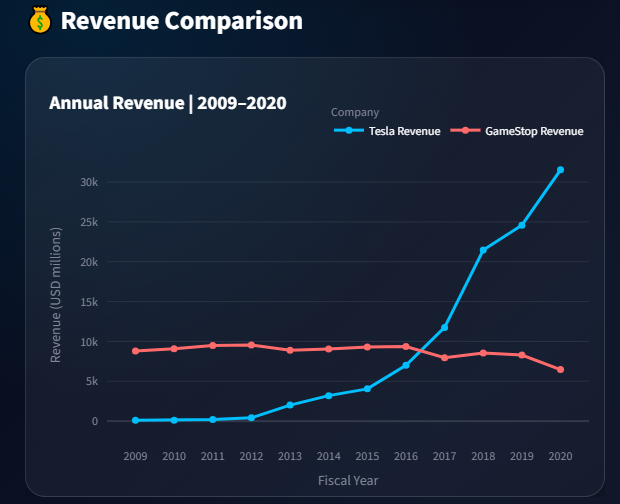
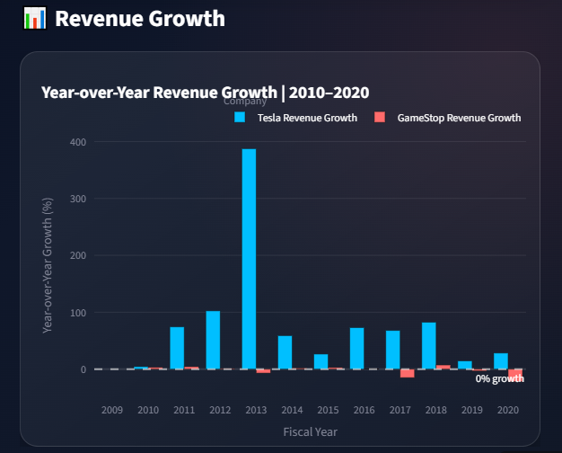
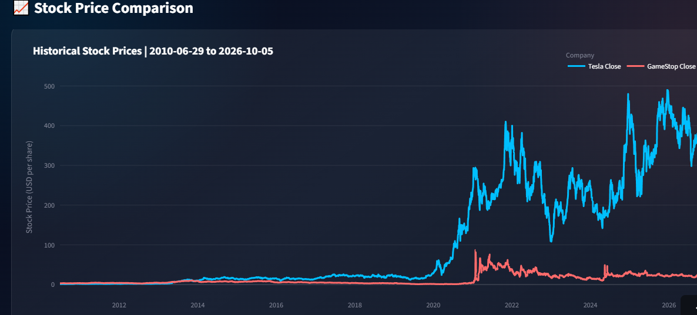

# Tesla vs. GameStop — Stock Performance & Revenue Analysis

A Python-based financial data analysis project comparing Tesla and GameStop through historical stock prices, revenue trends, year-over-year revenue growth, and normalized stock performance. The project combines financial data collection, web scraping, data cleaning, exploratory data analysis, and interactive visualizations.

## 📌 Project Overview

This project explores the historical financial performance of Tesla and GameStop by analyzing their stock market data and revenue trends.

Using Python, financial data collection, and web scraping, the analysis examines how the two companies' revenue and stock prices evolved over time. It also compares their revenue growth patterns and relative stock performance to identify notable trends and differences.

The project was developed using **Google Colab** for data collection, processing, analysis, and visualization, followed by an interactive **Streamlit dashboard** to present the findings.

## 🔗 Project Links

- **Google Colab Notebook:** [Explore the Full Analysis](https://colab.research.google.com/drive/168cDhOePUw-mxq-KbjzqoqnTrsBYh1nm)
- **Interactive Streamlit Dashboard:** [Launch the Dashboard](https://project-stock-performance-revenue-analysis-tesla-vs-gamestop-d.streamlit.app/#what-does-the-analysis-show)
- **GitHub Repository:** [View Source Code](https://github.com/FarahHossamEldin/Project-Stock-Performance-Revenue-Analysis-Tesla-vs-GameStop)

## 🎯 Project Objectives

- Collect historical stock market data for Tesla and GameStop.
- Retrieve and prepare historical revenue data through web scraping.
- Clean and transform financial datasets for analysis.
- Explore historical stock prices and revenue trends.
- Calculate and compare year-over-year revenue growth.
- Evaluate stock performance using actual prices and normalized indices.
- Identify key financial trends, growth patterns, and market movements.
- Communicate findings through clear visualizations and an interactive dashboard.

## 🛠️ Tools & Technologies

| Technology | Purpose |
|---|---|
| Google Colab | Notebook development and analysis |
| Python | Data analysis and processing |
| yfinance | Historical stock market data collection |
| Requests | Retrieving web page content |
| BeautifulSoup | Web scraping |
| Pandas | Data cleaning, transformation, and analysis |
| Matplotlib | Exploratory data visualization |
| Plotly | Interactive visualizations |
| Streamlit | Interactive dashboard development |

## 📥 Data Collection

### 1. Stock Market Data

Historical stock market data for Tesla and GameStop was collected using the `yfinance` Python library.

The datasets contain available historical market information, including:

- Date
- Open price
- High price
- Low price
- Closing price
- Trading volume

The collected data was prepared for historical trend analysis and stock performance comparison.

### 2. Revenue Data

Historical revenue data was collected through web scraping using:

- `Requests`
- `BeautifulSoup`
- `Pandas`

The scraped data was cleaned and converted into numeric values to make it suitable for financial analysis.

For the revenue comparison, the analysis focuses on the shared **2009–2020 period**, allowing both companies to be evaluated over the same historical timeframe.

## 🧹 Data Cleaning & Preparation

The collected datasets were inspected and prepared before analysis.

Key preparation steps included:

- Inspecting dataset structures and data types.
- Converting date columns into appropriate datetime formats.
- Cleaning scraped revenue values and converting them into numeric data.
- Sorting observations chronologically.
- Aligning the datasets for meaningful historical comparisons.

These steps helped ensure that the financial metrics and visualizations were based on consistently prepared data.

## 📊 Exploratory Data Analysis (EDA)

Exploratory analysis was conducted to understand the historical behavior of the two companies' revenue and stock prices.

The analysis examined:

- Historical revenue trends.
- Differences in financial performance.
- Periods of significant growth or decline.
- Changes in stock prices over time.
- Notable market movements and fluctuations.

Matplotlib was used for exploratory visualizations, while Plotly supported interactive charts.

### 📈 Revenue Growth Analysis

Year-over-year revenue growth was calculated using Pandas' pct_change() method.

The analysis compares the annual growth rates of Tesla and GameStop during their shared revenue period.

This helps identify:

Periods of rapid revenue expansion.

Years with negative revenue growth.

Differences in growth patterns between the companies.

Variations in annual growth that may not be apparent from revenue values alone.

The analysis also examines average annual growth and notable growth periods to provide additional context for interpreting long-term revenue trends.

### 📉 Stock Performance Analysis

Historical stock prices were analyzed to compare market performance over time.

The analysis examines:

Historical closing price trends.

Overall percentage changes in stock prices.

Differences in observed price movements.

Notable market periods, including the significant movements around 2020 and 2021.

Because the companies have different starting share prices, actual stock prices and percentage-based performance provide complementary perspectives rather than interchangeable measures.

### ⚖️ Normalized Stock Performance

To make relative stock performance easier to compare, both stocks are normalized to a starting index value of 100.

The calculation is:

Normalized Index = (Current Stock Price / Initial Stock Price) × 100

For example, a normalized index of 200 indicates that the stock price has doubled compared with its starting value, representing a 100% increase.

This approach allows the relative performance of Tesla and GameStop to be compared independently of their initial share prices.

## 📈 Project Visualizations

The notebook includes visualizations that support the analysis of revenue trends, annual growth, and historical stock performance.

### Revenue Comparison


### Revenue Growth Comparison


### Stock Price Comparison


Note: These images are static previews. Interactive Plotly visualizations can be explored in the notebook.

## 💡 Key Insights

- Revenue growth: Tesla experienced substantial revenue expansion over the shared 2009–2020 period, while GameStop's revenue followed a more variable trajectory.

- Year-over-year variation: Annual growth rates reveal fluctuations that cannot be fully understood by examining long-term revenue changes alone.

- Different performance measures: Revenue growth and stock-price performance reflect different aspects of a company's financial story.

- Market movements: Both companies experienced notable stock-price movements during the analyzed period, including significant changes around 2020 and 2021.

- Normalized comparison: Rebasing stock prices to 100 makes relative percentage performance easier to compare despite differences in initial share prices.

- Historical context matters: Conclusions depend on the selected timeframe, available data, and the financial metric being examined.

## 🔎 Conclusion

This project demonstrates a financial data analysis workflow using Python, from collecting real-world data and cleaning datasets to conducting exploratory analysis, evaluating revenue growth, and comparing historical stock performance.

The analysis highlights the importance of examining revenue trends, year-over-year growth, actual stock prices, and normalized performance together. Each metric offers a different perspective, and no single indicator fully explains a company's financial performance.

The key takeaway is that business performance and stock market performance should be analyzed together, but they should not be treated as interchangeable measures of success.

This project is intended for educational and analytical purposes only and does not constitute investment advice or a prediction of future returns.

## 🚀 Interactive Streamlit Dashboard

To make the analysis more accessible, an interactive Streamlit dashboard was developed to present the project's key findings and allow users to explore the financial data dynamically.

The dashboard complements the notebook by providing an interactive interface for exploring financial metrics, comparing company performance, and reviewing the main findings without manually running each analysis step.

### Dashboard Features

- Company Selection: Explore Tesla, GameStop, or compare both companies.

- Date-Range Filtering: Investigate stock performance over a selected period.

- KPI Cards: Review key stock performance metrics and the latest available stock-price date.

- Interactive Plotly Charts: Use hover details, zoom, and other chart interactions to investigate trends.

- Stock Price Analysis: Explore historical closing prices using interactive charts.
  
- Normalized Performance: Compare relative stock performance using a common starting index of 100.

- Revenue Comparison: Compare historical revenue trends across the shared 2009–2020 period.

- Revenue Growth Analysis: Examine annual growth rates and identify significant changes.
  
- Head-to-Head Comparison: Evaluate differences between the two companies across key financial indicators.

- Analytical Insights: Review key observations and a consolidated conclusion.


## ⚙️ How to Run the Project

### Run the Notebook

Open the Google Colab notebook to explore the complete analysis, including data collection, data cleaning, exploratory data analysis (EDA), revenue growth analysis, stock performance comparison, and key insights.

[Open the Google Colab Notebook](https://colab.research.google.com/drive/168cDhOePUw-mxq-KbjzqoqnTrsBYh1nm)

### Interactive Dashboard

Explore the interactive Streamlit dashboard to compare Tesla and GameStop stock performance and revenue trends.

[Open the Streamlit Dashboard](https://project-stock-performance-revenue-analysis-tesla-vs-gamestop-d.streamlit.app/#what-does-the-analysis-show)

### 📁 Project Structure

```text
Project-Stock-Performance-Revenue-Analysis-Tesla-vs-GameStop/
│
├── README.md
├── Stock_Performance_Revenue_Analysis.ipynb
├── app.py
├── requirements.txt
│
├── images/
│   ├── revenue_growth_comparison.png
│   ├── stock_price_comparison.png
│   └── revenue_comparison.png
│
└── data/
    ├── revenue_comparison.csv
    ├── revenue_growth_comparison.csv
    └── stock_comparison.csv
```


# 👩‍💻 Author

## Farah Hossam

###Data Science | Python | Data Analysis | Interactive Visualization

[LinkedIn](https://linkedin.com/in/farahhossam/)

[Portfolio](https://farahhossameldin.github.io/))

[Github](https://github.com/FarahHossamEldin)


###Driven by curiosity. Powered by data. Focused on impact.
